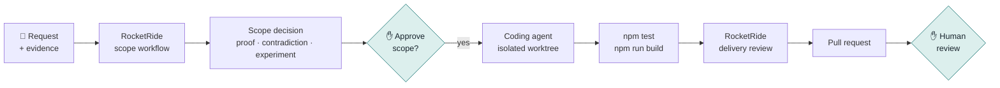

<div align="center">

<picture>
  <source media="(prefers-color-scheme: dark)" srcset="docs/assets/logo-dark.svg">
  <source media="(prefers-color-scheme: light)" srcset="docs/assets/logo-light.svg">
  
</picture>

### From product request to reviewed pull request, with the evidence attached.

**Signal scopes the work before a coding agent writes it, and shows you why.**

[](https://nodejs.org)
[](https://github.com/rocketride-org)
[](package.json)
[](#safety-and-current-limits)

[Quick start](#quick-start) · [How it works](#how-it-works) · [Features](#features) · [Live mode](#run-it-live-with-rocketride) · [Repository execution](#let-it-build-optional) · [FAQ](#faq)

<code>npm install && npm run dev</code>

<br />


</div>

---

> [!NOTE]
> Signal is a working prototype. The seed scenarios run fully offline. Live scoping needs a RocketRide server, and repository execution stays **off** until you enable it for one repository you trust.

## The problem

Most AI coding tools start too late. They jump from a one-line prompt straight to a diff, and the questions that matter get skipped: *Is this the right thing to build? What evidence says so? What would prove us wrong? Who signed off?* You end up with code nobody can trace back to a decision.

### How Signal solves it

1. **Scope before code.** Three specialist roles (Customer Advocate, Skeptic, Product Strategist) analyze your request and evidence in parallel, and a synthesis step reconciles them into one decision.
2. **Evidence you can click.** Every claim in the report links to the passage it came from. The strongest counterargument and a small, measurable next experiment are always included.
3. **A human at every gate.** A decision becomes a build mission only when you approve it. Code runs only in a repository you configured. The pull request waits for your review.
4. **Delivery that brings its receipts.** The coding agent works in an isolated worktree. Tests, build output, the diff, and a second RocketRide review go into the pull request with the change.

## Quick start

**Requirements:** Node.js 20+ and npm.

```bash
git clone https://github.com/Amitabh1998/signal.git
cd signal
npm install
npm run dev
```

Open **<http://127.0.0.1:4173>**. No API keys are needed to explore: the bundled seed scenarios render a complete report.

> [!TIP]
> Click **Guided tour** in the top bar, or open <http://127.0.0.1:4173/?tour=1>, for an eight-step walkthrough of the interface.

## How it works



**You describe the change.** Name the user, the behavior that should change, and any constraints worth protecting. Attach a brief, spec, notes, or data if they change the scope.

**Signal scopes it.** The request and files go to the RocketRide scope workflow. Three specialist roles work concurrently, a synthesis step reconciles them, and a JSON contract step validates the result before it reaches the UI. Models are told not to invent facts and to state uncertainty when evidence is thin.

**You review the decision.** You see the recommended bet, a confidence level, the signals behind it, the strongest counterargument, an open question to settle before building, and a reversible experiment. **Proof mode** lets you open the source passage behind every claim.

**You approve, and it builds.** **Create build mission** turns the decision into acceptance checks and a build queue. If you've enabled execution, **Run implementation** hands the mission to Codex CLI in a fresh `signal/*` worktree, runs your tests and build, has RocketRide review the delivery, and opens a pull request.

<div align="center">

<br />
<sub>A scope decision from a seed scenario: the recommendation, evidence-backed signals, and Proof mode claims linked to sources.</sub>
</div>

## Features

| | |
| --- | --- |
| 🧭 **Parallel specialist scoping** | Customer Advocate, Skeptic, and Product Strategist analyze the same evidence concurrently. |
| 🔎 **Proof mode** | Each claim carries its source, role, and support/challenge status. Click one to read the original passage. |
| ⚖️ **Built-in dissent** | Every report includes the strongest contradiction and caps confidence when skeptical evidence exists. |
| 🧪 **Reversible next step** | Instead of a roadmap, you get the smallest experiment that would confirm or kill the idea. |
| 📒 **Promise ledger** | Each specialist's commitments, and whether the returned evidence shows they were kept. |
| 🕸️ **Semantic spacetime map** | Explicit `supports` and `challenges` links between evidence, roles, and the decision. |
| 🏷️ **Honest provenance** | Seed, staged, imported, and live results are labeled differently. Signal never swaps in demo output when a live run fails. |
| 🌿 **Isolated builds** | The coding agent works in a temporary Git worktree on its own branch, never your working copy. |
| ✅ **Delivery review** | A second RocketRide workflow reviews the diff and test results before the pull request opens. |
| 🔐 **Credentials stay put** | **Connections** checks Codex and Claude Code sign-in status. Tokens stay in each CLI's own store. |

## Run it live with RocketRide

A live run needs **RocketRide Server v3.4.0**, running locally or in RocketRide Cloud. The engine is not bundled.

```bash
cp .env.example .env          # 1. configure the engine connection
npm run rocketride:check      # 2. verify the engine and both pipelines
npm run dev                   # 3. start Signal, then click "Run scope workflow"
```

<details>
<summary><b>Environment variables</b></summary>

```dotenv
ROCKETRIDE_URI=ws://localhost:5565
ROCKETRIDE_AUTH=your-engine-key
ROCKETRIDE_APIKEY=your-engine-key
ROCKETRIDE_OPENAI_KEY=your-openai-key
```

`ROCKETRIDE_OPENAI_KEY` must be set in the **RocketRide engine's** environment, because the pipelines' `llm_openai` nodes read it there. `npm run rocketride:check` prints `RocketRide health: PASS` only when the connection, ping, and both pipeline validations succeed.

</details>

<details>
<summary><b>Run the scope workflow from the command line</b></summary>

```bash
npm run seed:scenario -- --list
npm run seed:scenario -- --scenario browser-workflow-agent
npm run analyze:live -- --input data/seed-evidence.txt --output data/live-report.json
```

Refresh Signal and click **Load latest live run**, or use **Open completed report** to import any report the runner produced.

</details>

### The two workflows

Both pipelines use the same shape: parse the input, fan out to three concurrent LLM roles, reconcile, then enforce a JSON contract with RocketRide's `extract_data` node, which retries malformed output.

<table>
<tr>
<th width="50%"><a href="pipelines/signal-room.pipe"><code>signal-room.pipe</code></a>: scope decision</th>
<th width="50%"><a href="pipelines/delivery-review.pipe"><code>delivery-review.pipe</code></a>: delivery review</th>
</tr>
<tr>
<td>

```text
evidence → parse → question
  ├─ Customer Advocate ─┐
  ├─ Skeptic ───────────┼─ synthesis
  └─ Product Strategist ┘      │
                      JSON contract
                               │
                        decision report
```

</td>
<td>

```text
mission + diff + test results
  ├─ Change Reviewer ─────┐
  ├─ Quality Gatekeeper ──┼─ reconciliation
  └─ Release Skeptic ─────┘       │
                          JSON contract
                                  │
                           review report
```

</td>
</tr>
<tr>
<td>Recommendation, confidence, sources, signals, proof claims, contradiction, experiment, promise assessments, and relationship map.</td>
<td>A verdict on readiness for <b>human pull-request review</b>. It never approves a merge, release, or deployment.</td>
</tr>
</table>

## Let it build (optional)

> [!WARNING]
> Repository execution lets Signal run a coding agent and your project's npm scripts on this machine. Enable it only for a repository you trust, and keep the server on localhost.

Add to `.env`:

```dotenv
SIGNAL_EXECUTION_ENABLED=1
SIGNAL_EXECUTION_REPO=/absolute/path/to/trusted/repository
SIGNAL_EXECUTION_BASE=main
SIGNAL_EXECUTION_REMOTE=origin

SIGNAL_DELIVERY_REVIEW_ENABLED=1     # run the RocketRide delivery review
SIGNAL_DELIVERY_REVIEW_REQUIRED=0    # set to 1 to block the PR if the review fails
```

When you click **Run implementation**, the runner:

1. fetches the configured base branch and creates a temporary worktree on a new `signal/<run-id>` branch,
2. runs **Codex CLI** with the approved mission, restricted to that worktree,
3. runs `npm test` and `npm run build` if the repository defines them,
4. records the changed files, diff stats, and command results,
5. optionally sends that bundle to the RocketRide delivery review,
6. commits, pushes, and opens a pull request with **GitHub CLI**, with the review in the PR body,
7. removes the temporary worktree.

You'll need the `codex` CLI and an authenticated `gh`. Follow progress under **Builds**.

## Architecture

```text
Browser UI (index.html, src/)              Node server (scripts/serve.mjs, 127.0.0.1 only)
 ├─ work order + staged evidence    ──►     ├─ POST /api/analyze  → rocketride-run.mjs  → RocketRide Server
 ├─ decision · proof · ledger · map         ├─ POST /api/execute  → signal-execute.mjs  → Codex · git · gh
 └─ build mission + build status    ◄──     ├─ GET  /api/execution-status
                                            └─ GET  /api/runners
```

| Path | What's inside |
| --- | --- |
| [`src/`](src) | Browser app, report contract and validation, evidence utilities, seed scenarios |
| [`scripts/`](scripts) | Local server, RocketRide runners and health check, repository executor, eval, demo tooling |
| [`pipelines/`](pipelines) | RocketRide scope and delivery-review pipeline definitions |
| [`data/scenarios/`](data/scenarios) | Deterministic seed inputs for honest demos |
| [`tests/`](tests) | Report contract and behavior tests (`node --test`) |

Plain JavaScript, HTML, and CSS, with no frontend framework. The only runtime dependency is the [`rocketride`](https://www.npmjs.com/package/rocketride) SDK.

## Why Signal?

| | Prompt-to-code agent | Chat assistant | **Signal** |
| --- | :---: | :---: | :---: |
| Decides *whether* to build before building | — | Sometimes | ✅ |
| Claims linked to source evidence | — | Rarely | ✅ |
| Counterargument always surfaced | — | — | ✅ |
| Human approval before code runs | Varies | n/a | ✅ |
| Isolated branch + tests + build | Varies | — | ✅ |
| Independent review of the delivery | — | — | ✅ |

### Grounded in Promise Theory

Signal treats each specialist as an agent that can only promise its own behavior, such as *cite evidence*, *surface a rival explanation*, or *propose a reversible experiment*. The **promise ledger** checks those promises against the returned evidence and trace, so a prompt is never treated as a guarantee. The **semantic spacetime** map shows declared `supports` and `challenges` relationships, not similarity scores. Both are practical applications of Mark Burgess and Jan Bergstra's [Promise Theory](https://markburgess.org/promises.html) ([book, PDF](https://markburgess.org/BookOfPromises.pdf)), not new formal results.

## Commands

| Command | What it does |
| --- | --- |
| `npm run dev` | Start Signal at `http://127.0.0.1:4173` (`PORT` overrides) |
| `npm test` | Run the test suite |
| `npm run eval` | Check the evidence, proof, and confidence invariants |
| `npm run build` | Build the static app into `dist/` |
| `npm run rocketride:check` | Verify engine connectivity and validate both pipelines |
| `npm run analyze:live` | Run the scope workflow on an evidence file |
| `npm run delivery-review:live` | Run the delivery review on a delivery bundle |
| `npm run seed:scenario -- --list` | List the deterministic demo scenarios |
| `npm run sources:demo` | Generate a realistic multi-format source pack |
| `npm run demo:record` | Record an end-to-end walkthrough video (macOS + Chrome) |

### Trust checks

```bash
npm test && npm run eval && npm run build
```

`npm run eval` fails if a proof claim references a source that doesn't exist, quotes text that isn't in its source, shows a signal without a source label, or reports absolute confidence despite skeptical evidence.

## FAQ

<details>
<summary><b>Do I need an API key to try it?</b></summary>

No. `npm install && npm run dev` gives you the full interface with deterministic seed scenarios. You need a RocketRide server only to scope new requests live.

</details>

<details>
<summary><b>Is RocketRide an agent?</b></summary>

No. RocketRide is a pipeline runtime. Signal uses it to run two explicit, inspectable workflows with fixed roles and a validated output contract, not an open-ended autonomous loop.

</details>

<details>
<summary><b>Which coding agent does it use?</b></summary>

Builds are dispatched to **Codex CLI** today. **Connections** can also check Claude Code sign-in, but Claude Code isn't offered as a build runner until its dispatch integration exists.

</details>

<details>
<summary><b>Can Signal merge or deploy code?</b></summary>

No. The furthest it goes is opening a pull request. A `ready` delivery-review verdict means *ready for human review*, nothing more.

</details>

<details>
<summary><b>How do I know a report was really generated live?</b></summary>

Reports produced by the included runner are labeled live. Seed scenarios, staged files, and imported files are labeled as such. The UI validates an imported report's shape but tells you it can't prove where an arbitrary JSON file came from.

</details>

<details>
<summary><b>What file types can I attach?</b></summary>

TXT, Markdown, JSON, and CSV. PDF extraction, image OCR, and spreadsheet parsing aren't implemented yet.

</details>

## Safety and current limits

- **Localhost only.** The server binds to `127.0.0.1`. Don't expose it to an untrusted network, especially with execution enabled.
- **One trusted repository.** Execution is off by default and scoped to the single repository you configure. Passing tests don't replace code review.
- **Advisory review.** The delivery review informs the human reviewer. It never approves a release.
- **Local artifacts.** Live outputs such as `data/live-report.json` and rendered recordings are gitignored.
- **Bring your own engine.** Validated against RocketRide Server v3.4.0.

## Contributing

Before opening a pull request, run:

```bash
npm test && npm run eval && npm run build
```

Keep the honesty rules intact: never present seed, staged, or imported data as a live result, and keep every consequential step behind a human decision.

## Acknowledgements

- [RocketRide](https://github.com/rocketride-org) for the pipeline runtime behind both workflows.
- Mark Burgess and Jan Bergstra for [Promise Theory](https://markburgess.org/promises.html) and Semantic Spacetime.
- [Codex CLI](https://github.com/openai/codex) and [GitHub CLI](https://cli.github.com) for the build-and-review path.

## License

No license has been added to this repository yet.
