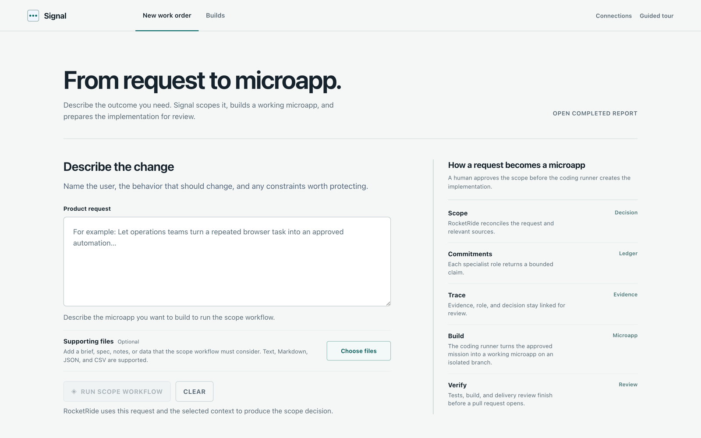
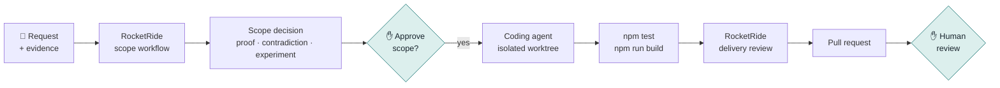
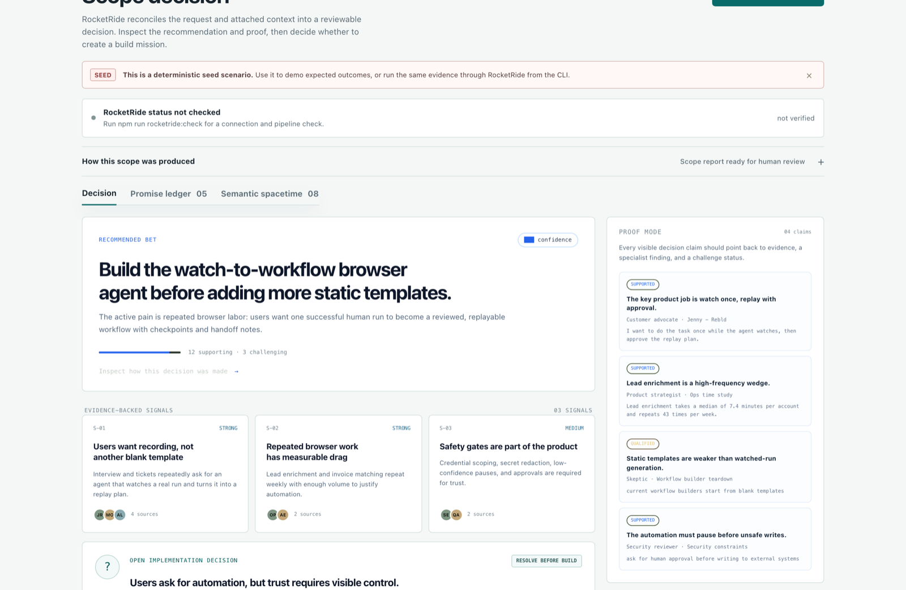

<div align="center">

<picture>
  <source media="(prefers-color-scheme: dark)" srcset="docs/assets/logo-dark.svg">
  <source media="(prefers-color-scheme: light)" srcset="docs/assets/logo-light.svg">
  
</picture>

### From product request to reviewed pull request, with the evidence attached.

**Signal scopes the work before a coding agent writes it, and shows you why.**

[](https://nodejs.org)
[](https://github.com/rocketride-org)
[](package.json)
[](#safety-and-current-limits)

[Quick start](#quick-start) · [How it works](#how-it-works) · [Features](#features) · [Live mode](#run-it-live-with-rocketride) · [Repository execution](#let-it-build-optional) · [FAQ](#faq)

<code>npm install && npm run dev</code>

<br />



</div>

---

> [!NOTE]
> Signal is a working prototype. The seed scenarios run fully offline. Live scoping needs a RocketRide server, and repository execution stays **off** until you enable it for one repository you trust.

## The problem

Most AI coding tools start too late. They jump from a one-line prompt straight to a diff, and the questions that matter get skipped: *Is this the right thing to build? What evidence says so? What would prove us wrong? Who signed off?* You end up with code nobody can trace back to a decision.

### How Signal solves it

1. **Scope before code.** Three specialist roles (Customer Advocate, Skeptic, Product Strategist) analyze your request and evidence in parallel, and a synthesis step reconciles them into one decision.
2. **Evidence you can click.** Every claim in the report links to the passage it came from. The strongest counterargument and a small, measurable next experiment are always included.
3. **A human at every gate.** A decision becomes a build mission only when you approve it. Code runs only in a repository you configured. The pull request waits for your review.
4. **Delivery that brings its receipts.** The coding agent works in an isolated worktree. Tests, build output, the diff, and a second RocketRide review that cites exact `path:line` locations go into the pull request with the change.

## Quick start

**Requirements:** Node.js 20+ and npm.

```bash
git clone https://github.com/Amitabh1998/signal.git
cd signal
npm install
npm run dev
```

Open **<http://127.0.0.1:4173>**. No API keys are needed to explore: the bundled seed scenarios render a complete report.

> [!TIP]
> Click **Guided tour** in the top bar, or open <http://127.0.0.1:4173/?tour=1>, for an eight-step walkthrough of the interface.

## How it works



**You describe the change.** Name the user, the behavior that should change, and any constraints worth protecting. Attach a brief, spec, notes, or data if they change the scope.

**Signal scopes it.** RocketRide's parse node reads every attached file from its raw bytes, spreadsheets included. The scope workflow then gives all of it to three specialist roles, an independent promise judge (GPT-4o) grades what each one committed to, a synthesis step (GPT-4o) reconciles them, and a JSON contract step validates the result before it reaches the UI. A live graph lights up each step as the engine reaches it. Models are told not to invent facts and to state uncertainty when evidence is thin. Signal records the engine's flow events, so you see the steps that actually ran, with timings.

**You review the decision.** You see the recommended bet, a confidence level, the signals behind it, the strongest counterargument, an open question to settle before building, and a reversible experiment. **Proof mode** lets you open the source passage behind every claim.

**You approve, and it builds.** **Create build mission** turns the decision into acceptance checks and a build queue. If you've enabled execution, **Run implementation** hands the mission to Claude Code (or Codex CLI) in a fresh `signal/*` worktree, runs your tests and build, has RocketRide review the delivery, and opens a pull request.

<div align="center">

<br />
<sub>A scope decision from a seed scenario: the recommendation, evidence-backed signals, and Proof mode claims linked to sources.</sub>
</div>

## Features

| | |
| --- | --- |
| 🧭 **Specialist scoping** | Customer Advocate, Skeptic, and Product Strategist each analyze the same evidence. |
| 🔎 **Proof mode** | Each claim carries its source, role, and support/challenge status, and is checked against the parsed source text. A quote that can't be found is flagged as unverified, never shown as supported. Click one to read the original passage. |
| ⚖️ **Built-in dissent** | Every report includes the strongest contradiction and caps confidence when skeptical evidence exists. |
| 🧪 **Reversible next step** | Instead of a roadmap, you get the smallest experiment that would confirm or kill the idea. |
| 📒 **Promise ledger** | Each specialist's commitment, graded kept, qualified, or broken by an independent Promise Judge. Signal reads the judge's verdicts from its own RocketRide output, so the synthesizer can't overwrite them. |
| 🕸️ **Semantic spacetime map** | Only declared `supports` and `challenges` links from evidence, through each role's finding, to the decision. Nothing is inferred from position or role names. |
| ⏱️ **Live graph, trace, and timeline** | The steps RocketRide actually executed, shown live during the run and afterwards with per-step timings, all from the engine's flow events. |
| 🗂️ **One workflow, many decisions** | **Decisions** lists completed live runs side by side, each with its own bet, contradiction, and next experiment. |
| 📎 **Rich evidence** | Attach TXT, Markdown, JSON, JSONL, CSV, or XLSX. RocketRide's parse node reads each file, and its parsed tables appear under **Parsed by RocketRide**. |
| 🏷️ **Honest provenance** | Seed, staged, imported, and live results are labeled differently. Signal never swaps in demo output when a live run fails. |
| 🌿 **Isolated builds** | The coding agent works in a temporary Git worktree on its own branch, never your working copy. |
| ✅ **Agent-read delivery review** | A RocketRide agent reads the committed diff with read-only `tool_git`, then three reviewers cite `path:line` locations that Signal verifies against the commit. |
| 🔐 **Credentials stay put** | **Connections** checks Claude Code and Codex sign-in status. Tokens stay in each CLI's own store. |

## Run it live with RocketRide

A live run needs a **RocketRide engine** and an [OpenRouter](https://openrouter.ai) API key. The quickest path runs the engine locally with Docker:

```bash
cp .env.example .env          # 1. add ROCKETRIDE_OPENROUTER_KEY to .env
npm run rocketride:up         # 2. start the RocketRide engine on 127.0.0.1:5565
npm run rocketride:check      # 3. verify the engine and all three pipelines
npm run dev                   # 4. start Signal, then click "Run scope workflow"
```

You can also point Signal at an existing RocketRide server or RocketRide Cloud instead of Docker.

<details>
<summary><b>Environment variables</b></summary>

```dotenv
ROCKETRIDE_URI=ws://localhost:5565
ROCKETRIDE_AUTH=
ROCKETRIDE_APIKEY=your-engine-key
ROCKETRIDE_OPENROUTER_KEY=your-openrouter-key
```

The pipelines call models through OpenRouter's OpenAI-compatible endpoint, so `ROCKETRIDE_OPENROUTER_KEY` must be available to the **RocketRide engine process**. `npm run rocketride:up` passes it from `.env` into the container. `npm run rocketride:check` prints `RocketRide health: PASS` only when the connection, ping, and every pipeline validation succeed.

</details>

<details>
<summary><b>Run the scope workflow from the command line</b></summary>

```bash
npm run seed:scenario -- --list
npm run seed:scenario -- --scenario browser-workflow-agent
npm run analyze:live -- --input data/seed-evidence.txt --output data/live-report.json
```

Refresh Signal and click **Open latest live run**, or use **Open completed report** to import any report the runner produced.

</details>

### The workflows

[`evidence-parse.pipe`](pipelines/evidence-parse.pipe) runs RocketRide's `parse` node on each uploaded file's raw bytes and returns its text and tables. The two decision workflows then share a shape: three LLM roles, a reconciliation step, and a JSON contract enforced by RocketRide's `extract_data` node, which retries malformed output. Signal records the engine's flow events for all of them, so the trace you see is the one that ran.

<table>
<tr>
<th width="50%"><a href="pipelines/signal-room.pipe"><code>signal-room.pipe</code></a>: scope decision</th>
<th width="50%"><a href="pipelines/delivery-review.pipe"><code>delivery-review.pipe</code></a>: delivery review</th>
</tr>
<tr>
<td>

```text
evidence → parse
  ├─ Customer Advocate ─┐
  ├─ Skeptic ───────────┼─ promise judge
  └─ Product Strategist ┘       │
                            synthesis
                                │
                          JSON contract
                                │
                         decision report
```

</td>
<td>

```text
mission + commit range + test output
              │
  diff reader agent ── tool_git (read-only)
              │        git.diff(base..head)
  ├─ Change Reviewer ─────┐
  ├─ Quality Gatekeeper ──┼─ reconciliation
  └─ Release Skeptic ─────┘       │
                          JSON contract
                                  │
                           review report
```

</td>
</tr>
<tr>
<td>Recommendation, confidence, sources, signals, proof claims, contradiction, experiment, promise assessments, and relationship map.</td>
<td>A verdict on readiness for <b>human pull-request review</b>, with the agent's real <code>git.diff</code> call, and findings that cite <code>path:line</code> locations Signal checks against the commit. It never approves a merge, release, or deployment.</td>
</tr>
</table>

## Let it build (optional)

> [!WARNING]
> Repository execution lets Signal run a coding agent and your project's npm scripts on this machine. Enable it only for a repository you trust, and keep the server on localhost.

Add to `.env`:

```dotenv
SIGNAL_EXECUTION_ENABLED=1
SIGNAL_EXECUTION_REPO=/absolute/path/to/trusted/repository
SIGNAL_EXECUTION_RUNNER=claude       # claude (default) or codex
SIGNAL_EXECUTION_BASE=main
SIGNAL_EXECUTION_REMOTE=origin
SIGNAL_EXECUTION_PR_MODE=github      # or local: push a review branch, no PR

SIGNAL_DELIVERY_REVIEW_ENABLED=1     # run the RocketRide delivery review
SIGNAL_DELIVERY_REVIEW_REQUIRED=0    # set to 1 to block the PR if the review fails
```

When you click **Run implementation**, the runner:

1. fetches the configured base branch and creates a temporary worktree on a new `signal/<run-id>` branch,
2. runs the coding agent with the approved mission:
   - **Claude Code** (default) runs headless with edits auto-accepted inside the worktree and shell access limited to `npm test`, `npm run build`, and read-only git,
   - **Codex CLI** runs with workspace-write access to the worktree,
3. runs `npm test` and `npm run build` if the repository defines them,
4. commits the change locally,
5. optionally runs the RocketRide delivery review, whose agent reads that commit with read-only git tools,
6. pushes the reviewed commit only after the review, then opens a pull request with **GitHub CLI** with the review in the PR body (in `local` mode it stops at the pushed review branch),
7. removes the temporary worktree.

You'll need an authenticated `claude` (or `codex`) CLI, plus `gh` for GitHub mode. Follow progress under **Builds**. Each run is saved under `data/runs/`, and a run interrupted by a server restart is marked as failed rather than left hanging.

> [!TIP]
> To try the full build loop without touching a real repository, run `npm run demo:target`. It creates a small demo app with a local bare Git remote under `.context/` and prints the `SIGNAL_EXECUTION_*` values to use. Set `SIGNAL_EXECUTION_PR_MODE=local`, since a local remote can't host a pull request.

## Architecture

```text
Browser UI (index.html, src/)              Node server (scripts/serve.mjs, 127.0.0.1 only)
 ├─ work order + staged evidence    ──►     ├─ POST /api/analyze          → rocketride-run.mjs → evidence-parse.pipe → signal-room.pipe
 ├─ live scope graph                        ├─ GET  /api/scope-progress   → steps the engine has started (flow events)
 ├─ decisions (completed live runs)         ├─ GET  /api/decisions        → completed live scope runs
 ├─ decision · proof · ledger · map         ├─ POST /api/execute          → signal-execute.mjs → Claude Code / Codex · git · gh
 ├─ engine trace + timeline                 ├─ GET  /api/runs/:id         → saved run records (data/runs/)
 └─ build mission + build status    ◄──     ├─ GET  /api/executions/:id   → live build progress
                                            ├─ GET  /api/execution-status
                                            ├─ GET  /api/runners
                                            └─ POST /api/runners/:runner/login
```

| Path | What's inside |
| --- | --- |
| [`src/`](src) | Browser app, report contract and validation, evidence utilities, seed scenarios |
| [`scripts/`](scripts) | Local server, RocketRide runners and health check, repository executor, eval, demo tooling |
| [`pipelines/`](pipelines) | RocketRide scope and delivery-review pipeline definitions |
| [`data/scenarios/`](data/scenarios) | Deterministic seed inputs for honest demos |
| [`demo/target-template/`](demo/target-template) | Small app that `npm run demo:target` turns into a safe build target |
| [`docker-compose.rocketride.yml`](docker-compose.rocketride.yml) | Local RocketRide engine used by `npm run rocketride:up` |
| [`tests/`](tests) | Report contract and behavior tests (`node --test`) |

Plain JavaScript, HTML, and CSS, with no frontend framework. There are two runtime dependencies: the [`rocketride`](https://www.npmjs.com/package/rocketride) SDK and [`read-excel-file`](https://www.npmjs.com/package/read-excel-file) for XLSX evidence.

## Why Signal?

| | Prompt-to-code agent | Chat assistant | **Signal** |
| --- | :---: | :---: | :---: |
| Decides *whether* to build before building | — | Sometimes | ✅ |
| Claims linked to source evidence | — | Rarely | ✅ |
| Counterargument always surfaced | — | — | ✅ |
| Human approval before code runs | Varies | n/a | ✅ |
| Isolated branch + tests + build | Varies | — | ✅ |
| Independent review of the delivery | — | — | ✅ |

### Grounded in Promise Theory

Signal treats each specialist as an agent that can only promise its own behavior, such as *cite evidence*, *surface a rival explanation*, or *propose a reversible experiment*. The **promise ledger** checks those promises against the returned evidence and trace, so a prompt is never treated as a guarantee. The **semantic spacetime** map shows declared `supports` and `challenges` relationships, not similarity scores. Both are practical applications of Mark Burgess and Jan Bergstra's [Promise Theory](https://markburgess.org/promises.html) ([book, PDF](https://markburgess.org/BookOfPromises.pdf)), not new formal results.

## Commands

| Command | What it does |
| --- | --- |
| `npm run dev` | Start Signal at `http://127.0.0.1:4173` (`PORT` overrides) |
| `npm test` | Run the test suite |
| `npm run eval` | Check the evidence, proof, and confidence invariants |
| `npm run build` | Build the static app into `dist/` |
| `npm run rocketride:up` | Start a local RocketRide engine with Docker (`:down` stops it, `:logs` follows it) |
| `npm run rocketride:check` | Verify engine connectivity and validate all three pipelines |
| `npm run analyze:live` | Run the scope workflow on an evidence file |
| `npm run delivery-review:live` | Run the delivery review on a delivery bundle |
| `npm run seed:scenario -- --list` | List the deterministic demo scenarios |
| `npm run sources:demo` | Generate a realistic multi-format source pack |
| `npm run demo:target` | Create an isolated demo repository and local remote for trying builds |
| `npm run demo:record` | Record an end-to-end walkthrough video (macOS + Chrome) |

### Trust checks

```bash
npm test && npm run eval && npm run build
```

`npm run eval` fails if a proof claim references a source that doesn't exist, quotes text that isn't in its source, shows a signal without a source label, or reports absolute confidence despite skeptical evidence.

## FAQ

<details>
<summary><b>Do I need an API key to try it?</b></summary>

No. `npm install && npm run dev` gives you the full interface with deterministic seed scenarios. You need a RocketRide engine and an OpenRouter key only to scope new requests live.

</details>

<details>
<summary><b>Is RocketRide an agent?</b></summary>

No. RocketRide is a pipeline runtime. Signal uses it to run two explicit, inspectable workflows with fixed roles and a validated output contract, not an open-ended autonomous loop.

</details>

<details>
<summary><b>Which coding agent does it use?</b></summary>

**Claude Code** by default, running headless. Set `SIGNAL_EXECUTION_RUNNER=codex` to use **Codex CLI** instead. **Connections** shows whether each CLI is signed in.

</details>

<details>
<summary><b>Can Signal merge or deploy code?</b></summary>

No. The furthest it goes is opening a pull request. A `ready` delivery-review verdict means *ready for human review*, nothing more.

</details>

<details>
<summary><b>How do I know a report was really generated live?</b></summary>

Reports produced by the included runner are labeled live. Seed scenarios, staged files, and imported files are labeled as such. The UI validates an imported report's shape but tells you it can't prove where an arbitrary JSON file came from.

</details>

<details>
<summary><b>What file types can I attach?</b></summary>

TXT, Markdown, JSON, JSONL, CSV, and XLSX. Each spreadsheet sheet is converted to rows the workflow can read and cite. PDF extraction and image OCR aren't implemented yet.

</details>

## Safety and current limits

- **Localhost only.** The server binds to `127.0.0.1`. Don't expose it to an untrusted network, especially with execution enabled.
- **One trusted repository.** Execution is off by default and scoped to the single repository you configure. Passing tests don't replace code review.
- **Advisory review.** The delivery review informs the human reviewer. It never approves a release.
- **Local artifacts.** Live outputs such as `data/live-report.json`, run records in `data/runs/`, and rendered recordings are gitignored.
- **Engine runs separately.** Start it with Docker (`npm run rocketride:up`) or point Signal at your own RocketRide server or Cloud endpoint.

## Contributing

Before opening a pull request, run:

```bash
npm test && npm run eval && npm run build
```

Keep the honesty rules intact: never present seed, staged, or imported data as a live result, and keep every consequential step behind a human decision.

## Acknowledgements

- [RocketRide](https://github.com/rocketride-org) for the pipeline runtime behind both workflows.
- Mark Burgess and Jan Bergstra for [Promise Theory](https://markburgess.org/promises.html) and Semantic Spacetime.
- [Claude Code](https://claude.com/claude-code), [Codex CLI](https://github.com/openai/codex), and [GitHub CLI](https://cli.github.com) for the build-and-review path.
- [OpenRouter](https://openrouter.ai) for model access inside the pipelines.

## License

No license has been added to this repository yet.
